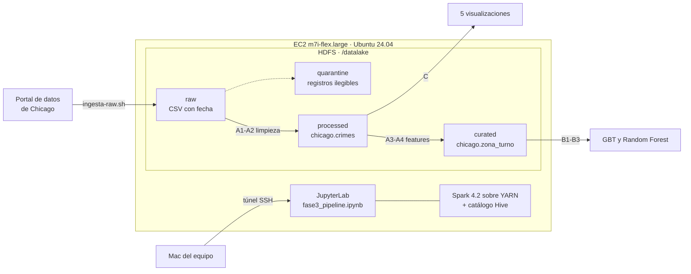

# Documentación general del proyecto

> Proyecto integrador de tecnologías de Big Data · Predicción de delitos en Chicago
> **Equipo:** Valentino De Paola Gallardo · Carlos David Gonzalez Davila · Eduardo Lopez Uresti
> Última actualización: 19 de noviembre de 2026 (issues #20, #21 y #22)

Este documento es la vista de conjunto del proyecto: qué es, cómo está armado, qué resultados tenemos y qué sigue. El detalle de cada fase vive en su propio documento (ver [Mapa de documentos](#mapa-de-documentos)).

---

## 1. Qué es el proyecto

**Pregunta de negocio (Fase 2):** ¿en qué zonas, días y horarios de Chicago es más probable que ocurra un delito en las próximas semanas, y de qué tipo?

**Para quién:** el mando policial que decide a qué zonas y turnos mandar más patrullas.

**Datos:** los delitos de 2025 del portal de datos abiertos de Chicago (dataset [`t7ek-mgzi`](https://data.cityofchicago.org/d/t7ek-mgzi)): 238,174 incidentes y 22 columnas en la descarga del 23/10/2026. El portal sigue agregando reportes tardíos, por eso cada descarga se guarda con su fecha.

**Metodología:** CRISP-DM, una fase del proyecto por cada etapa.

---

## 2. Estado por fase

| Fase | Qué cubre | Estado | Documento |
|---|---|---|---|
| 2 | Plan CRISP-DM (entendimiento del negocio y de los datos) y arquitectura objetivo | Terminada | [Google Doc](https://docs.google.com/document/d/1j1llfIa9vETELeaJd5Plgcu2zRa5RBDYazHdIkCQM-Q/edit) |
| 3 | Preparación de datos y modelado con PySpark (CRISP-DM III y IV): pipeline, 2 modelos de SparkML y 5 visualizaciones | Terminada (entrega del 31/10/2026) | [Fase3-Plan-y-Alcance.md](Fase3-Plan-y-Alcance.md) · [reporte](https://docs.google.com/document/d/1busfqhp9NKxw8cqSSDjHEdvcW76X-H7xUQmDmYC-Li0/edit) |
| 4 | Resultados e impacto de negocio, a partir de los modelos de la Fase 3 | Por arrancar | — |

---

## 3. Arquitectura actual

La Fase 2 planteó un clúster de 4 nodos en Azure con Airflow, Kafka, MLflow, API REST y Power BI. Por costo y disponibilidad implementamos una **versión mínima en AWS** que cubre lo que piden las fases (el porqué está en [Fase3-Plan-y-Alcance.md](Fase3-Plan-y-Alcance.md#infraestructura-respecto-a-la-fase-2)).

| Pieza | Qué usamos |
|---|---|
| Nube | AWS, `us-east-1`, cuenta personal en plan gratuito (perfil `bigdata`) |
| Servidor | Una EC2 `m7i-flex.large` (2 vCPU, 8 GiB, 30 GB) creada con Terraform ([`infra/`](../infra/)) |
| Almacenamiento | Hadoop 3.5.0 (HDFS + YARN) pseudo-distribuido, Java 17 |
| Procesamiento | Spark 4.2.0 + PySpark + SparkML sobre YARN |
| SQL | Spark SQL con catálogo Hive (metastore Derby), base `chicago` |
| Notebooks | JupyterLab en `~/venv`, al que se entra por túnel SSH (no hay puertos abiertos) |
| Visualización | matplotlib, seaborn y plotly dentro del notebook |

Cómo encenderla, arrancar los servicios y apagar todo: [Guia-Instancia-AWS.md](Guia-Instancia-AWS.md).

---

## 4. Data lake y tablas

| Capa | Ruta en HDFS | Tabla Hive | Qué tiene |
|---|---|---|---|
| raw | `/datalake/raw/crimes_<año>/fecha=<AAAA-MM-DD>/` | — | El CSV de cada año (2022 a 2025) tal como lo entrega el portal, más `_ingesta.json` con el conteo contra la API |
| quarantine | `/datalake/quarantine/crimes_<años>/fecha=<AAAA-MM-DD>/` | — | Registros que no se pudieron leer (en la corrida actual, solo el encabezado) |
| processed | `/datalake/processed/crimes_2025/` | `chicago.crimes` | Incidentes limpios: las 22 columnas de la plantilla, fechas en UTC, banderas `hora_imputada` y `coord_imputada` |
| curated | `/datalake/curated/zona_turno_2025/` | `chicago.zona_turno` | Una fila por beat × turno de 6 h × semana, con variables de semanas anteriores, la columna `conjunto` y el vector `features` |
| curated | `/datalake/curated/zona_turno_variables_2022_2025/` | `chicago.zona_turno_variables_2022_2025` | La tabla zona-turno de 2022 a 2025 con las variables nuevas del #21 (retrasos, estacionalidad, vecinos, festivos y clima), desde la semana 4 de 2023 |
| raw | `/datalake/raw/clima_ohare/fecha=<AAAA-MM-DD>/` | — | Clima diario de O'Hare de 2022 a 2025 (Open-Meteo), cargado con `scripts/ingesta-clima.sh` |

Las corridas con varios años (`ANIOS` en el notebook) guardan sus capas aparte con el sufijo de los años: `crimes_2022_2025`, `zona_turno_2022_2025` y las tablas `chicago.crimes_2022_2025` y `chicago.zona_turno_2022_2025`. Cada corrida deja también su tabla de métricas en `/datalake/curated/metricas_<años>/`, que lee la sección B4.

Reglas del dataset limpio: tiene que conservar exactamente las columnas que documenta la plantilla ([`notebooks/00_plantilla.ipynb`](../notebooks/00_plantilla.ipynb)) y no se modifica `cargar_crimenes()`.

---

## 5. Pipeline

Todo vive en un solo notebook, [`notebooks/fase3_pipeline.ipynb`](../notebooks/fase3_pipeline.ipynb), que corre igual en local (`LOCAL = True`) y en el clúster (`LOCAL = False`). `ANIOS = [2025]` reproduce la Fase 3; `ANIOS = [2022, 2023, 2024, 2025]` repite todo con cuatro años (issue #20).

| Paso | Qué hace | Resultado |
|---|---|---|
| Ingesta | `scripts/ingesta-raw.sh <año>` descarga el CSV de un año y lo sube a raw con la fecha de descarga | 238,174 incidentes |
| A1 · Exploración | Esquema, estadísticas, tabla variable · tipo · % nulos | 22 columnas |
| A2 · Limpieza | Nulos según la Fase 2, duplicados exactos, atípicos con IQR sobre coordenadas | No se pierde ningún registro; 2,377 coordenadas imputadas con la mediana del beat; 14,570 horas imputadas marcadas |
| A3 · Features | Malla zona-turno-semana con ceros, 4 variables de semanas anteriores, `StringIndexer`, `OneHotEncoder`, `StandardScaler`, `VectorAssembler` | 52,608 filas (semanas 4 a 51), vector de 28 posiciones |
| A4 · Guardado | Parquet en curated y tabla Hive | `chicago.zona_turno` |
| B1 y B2 · Modelos | `GBTRegressor` y `RandomForestRegressor` con ajuste ligero de hiperparámetros | Métricas técnicas y de negocio |
| B3 · Comparación | Tabla, comparación semana a semana y elección | Random Forest |
| B4 · Un año contra cuatro | Junta las métricas de la corrida de 2025 y la de 2022–2025 | Tabla comparativa |
| C · Visualizaciones | 5 gráficas, una por pregunta analítica | [`notebooks/figuras/`](../notebooks/figuras/) |

---

## 6. Modelos y resultados

**Qué predicen:** cuántos incidentes habrá la próxima semana en cada zona-turno (un beat en un bloque de 6 horas). Con eso se ordenan las zonas-turno y se señala el 10 % más activo.

**Métricas en las 10 semanas de prueba (42 a 51):**

| Modelo | RMSE | MAE | R² | Captura | PAI |
|---|---|---|---|---|---|
| Promedio histórico de la zona-turno | 2.101 | 1.614 | 0.372 | 20.0 % | 2.00 |
| **Random Forest** (elegido) | 2.117 | 1.642 | 0.363 | 19.8 % | 1.98 |
| GBT | 2.132 | 1.655 | 0.354 | 19.8 % | 1.98 |
| Promedio de 4 semanas (línea base de la Fase 2) | 2.259 | 1.722 | 0.275 | 19.0 % | 1.90 |

Captura máxima posible (si se supiera el futuro): 26.0 %.

**Conclusiones:**

- Random Forest tiene menos error que GBT en las 10 semanas de prueba y entrena en un tercio del tiempo, sin perder captura. Por eso se eligió.
- Los dos modelos le ganan a la línea base de la Fase 2 (promedio de 4 semanas), pero **ninguno le gana al promedio histórico** de cada zona-turno, que además es la variable que más pesa en los dos.
- Señalar el 10 % de zonas-turno que marca el modelo cubre cerca del 20 % de los incidentes: el doble de lo que tocaría al azar y el 76 % de lo que lograría un modelo perfecto.
- Las metas de la Fase 2 (captura ≥ 40 %, PAI ≥ 3) no se alcanzan con esta unidad de análisis: ni un modelo perfecto pasa del 26 %.
- El **tipo de delito** no lo predice ningún modelo; por ahora lo responde la visualización de la pregunta 3.

### Un año contra cuatro (issue #20)

Se repitió todo con 2022 a 2025 (1,002,283 incidentes crudos, 227,968 zonas-turno-semana). Los modelos entrenan con todo lo anterior a la prueba (194 semanas) y se prueban con las mismas 10 semanas de 2025. Corrida en el clúster del 18/11/2026: [`notebooks/fase3_pipeline_2022_2025.ipynb`](../notebooks/fase3_pipeline_2022_2025.ipynb), y la tabla completa en la sección B4 de `fase3_pipeline.ipynb`.

| Modelo | MAE 2025 | MAE 2022–2025 | Captura 2025 | Captura 2022–2025 | Semanas con menor MAE que su promedio histórico (2022–2025) |
|---|---|---|---|---|---|
| Promedio histórico | **1.614** | 1.661 | **20.0 %** | 19.5 % | — |
| Random Forest | 1.642 | 1.655 | 19.8 % | 19.7 % | **8 de 10** |
| GBT | 1.655 | 1.666 | 19.8 % | 19.7 % | 5 de 10 |
| Promedio de 4 semanas | 1.722 | 1.722 | 19.0 % | 19.0 % | 3 de 10 |

- **Con cuatro años, Random Forest por fin le gana a su promedio histórico**, en 8 de las 10 semanas de prueba. Con un año no le ganaba en ninguna.
- **Pero todo queda peor que con un año.** El mejor resultado sigue siendo el promedio histórico de 2025 solo. En 2023 y 2024 hubo más delitos que en 2025 (pregunta 4 con los cuatro años), así que promediar toda la historia sobreestima el final de 2025: lo que más anticipa una zona-turno es su nivel reciente.
- **Más historia sola no basta.** Hace falta darle al modelo variables que la aprovechen: la semana del año y el retraso de 52 semanas (issue #21), que con cuatro años ya tienen sentido.
- Un beat (1650) no aparece en todos los años y quedó fuera de la malla (116 incidentes).

### Variables nuevas (issue #21)

Sobre la tabla de 2022 a 2025 se agregaron cinco grupos de variables y se midió cada uno con Random Forest (mismos hiperparámetros, mismas filas desde la semana 4 de 2023 y mismas semanas de prueba). Detalle en [`notebooks/variables_nuevas.ipynb`](../notebooks/variables_nuevas.ipynb), corrida en el clúster del 18/11/2026.

| Modelo | MAE | Captura | Semanas con menor MAE que el promedio histórico |
|---|---|---|---|
| **Random Forest con variables nuevas** | **1.585** | 19.9 % | **10 de 10** |
| Promedio de las últimas 52 semanas (regla simple) | 1.609 | 20.0 % | — |
| Random Forest de la Fase 3, mismas filas | 1.643 | 19.6 % | 8 de 10 |
| Promedio histórico | 1.661 | 19.5 % | — |

Lo que aporta cada grupo por separado, sobre el MAE de 1.643 de la base: retrasos (hace 2 y 52 semanas y promedio de 52 semanas) lo bajan a 1.614, estacionalidad a 1.622, vecinos a 1.635 y festivos a 1.642. El clima real de la semana lo baja a 1.606 solo y a 1.574 con todo, pero es optimista: en la práctica haría falta un pronóstico.

- **El modelo por fin le gana al promedio histórico**, en las 10 semanas de prueba, y también al promedio histórico de 2025 solo (1.614), que era lo mejor hasta ahora.
- **La clave fue olvidar los años viejos.** `promedio_52_semanas` pesa casi el 40 % del modelo. Esa misma regla, sin modelo, ya tiene MAE de 1.609; Random Forest le gana en 8 de 10 semanas, por 0.024 incidentes.
- **La captura casi no se mueve** (19.9 %, el 76 % del máximo posible): bajar el error medio no cambia mucho cuáles son el 10 % de zonas-turno más activas.
- El ajuste con tres ventanas de tiempo volvió a elegir 8 de profundidad y 50 árboles.

### Tipo de delito (issue #22)

Un clasificador para cada incidente de 2023 a 2025, con 7 clases (THEFT, BATTERY, CRIMINAL DAMAGE, ASSAULT, MOTOR VEHICLE THEFT, OTHER OFFENSE y OTROS; sin NARCOTICS ni WEAPONS VIOLATION) y solo variables que se conocen antes del incidente: la mezcla de tipos de la zona-turno en las 52 semanas anteriores, el turno, el día, la semana del año y el distrito. Misma prueba que los demás modelos (semanas 42 a 51 de 2025). Detalle en [`notebooks/tipo_de_delito.ipynb`](../notebooks/tipo_de_delito.ipynb), corrida en el clúster del 19/11/2026.

| Modelo | Exactitud | F1 macro | Tipo real entre los 2 más probables | Error de la mezcla por zona-turno |
|---|---|---|---|---|
| Regresión logística multinomial | 29.4 % | 0.156 | 48.5 % | 4.66 puntos |
| Random Forest | 29.3 % | 0.139 | 48.5 % | — |
| Tipo más frecuente de la zona-turno (último año) | 29.1 % | 0.156 | 48.9 % | 4.65 puntos |
| Tipo más común de la ciudad | 24.6 % | 0.056 | 44.0 % | 6.44 puntos |

- **Ningún clasificador le gana a la regla de la zona-turno.** El tipo depende sobre todo de dónde, y la mezcla del último año ya lo dice: pesa más del 70 % en Random Forest. Turno, día y semana del año casi no cambian el tipo una vez que se sabe la zona.
- **Sirve para anticipar la mezcla, no el incidente.** La mezcla de cada zona-turno se anticipa con un error de 4.7 puntos (6.4 con la de la ciudad), pero el tipo de un incidente suelto se acierta 3 de cada 10 veces. Las clases chicas (ASSAULT, MOTOR VEHICLE THEFT, OTHER OFFENSE) casi nunca son la más probable.

---

## 7. Hallazgos principales

| Pregunta | Respuesta |
|---|---|
| ¿Dónde? | Centro, oeste y sur (distritos 8, 12, 1, 6 y 18). El 10 % de las celdas de 500 m concentra el 35.6 % de los incidentes |
| ¿Cuándo? | Por la tarde (pico a las 15:00; de 15:00 a 19:00 entre semana) y la madrugada del sábado y el domingo. El 60.7 % ocurre de mediodía a medianoche. 9 % más en verano |
| ¿Qué tipo? | Robo sin violencia (23.2 %), agresión física (17.9 %) y daño a la propiedad (11.0 %) suman más de la mitad |
| ¿Qué tan desigual? | El 10 % de zonas-turno más activo concentra el 20.4 % de los incidentes; la mitad menos activa, el 32.1 % |

---

## 8. Decisiones que aplican a todo el proyecto

Las decisiones completas, con su justificación, están en [Fase3-Plan-y-Alcance.md](Fase3-Plan-y-Alcance.md#decisiones). Estas son las que cualquier fase siguiente tiene que respetar o cambiar a propósito:

| Decisión | Valor actual |
|---|---|
| Unidad de análisis | Zona-turno: beat × bloque de 6 h × semana de 7 días desde el 1 de enero |
| División entrenamiento/prueba | Por fecha, nunca aleatoria: las semanas 42 a 51 del último año prueban y todo lo anterior entrena (con 2025: semanas 4 a 41). Columna `conjunto` |
| Exclusiones para modelar | Hora imputada, NARCOTICS y WEAPONS VIOLATION (sesgo de patrullaje) y beat 6100 (no es una zona real) |
| Atípicos | IQR sobre coordenadas; solo se eliminan puntos fuera de Chicago. Los extremos reales son la señal que buscamos |
| Variables | Solo miran semanas anteriores (sin fugas del futuro); el escalado se ajusta solo con entrenamiento |
| Métricas | RMSE, MAE y R², más captura y PAI sobre el 10 % de zonas-turno, siempre contra las referencias simples y el máximo posible |
| Fechas | En UTC, como las interpreta `cargar_crimenes()` |

---

## 9. Limitaciones conocidas

- **Estacionalidad sin variables que la capten.** Con cuatro años el modelo ya ve varios veranos, pero no tiene la semana del año ni el retraso de 52 semanas, así que no la aprovecha (#21). Las semanas de prueba (octubre a diciembre) caen en temporada baja.
- **El historial reciente domina.** Con las variables del #21 el modelo le gana al promedio histórico, pero casi toda su fuerza viene de promedios de la propia zona-turno: la regla de 52 semanas sola queda a 0.024 de MAE del modelo.
- **El tipo de delito se anticipa solo como mezcla.** El clasificador del #22 no le gana a la mezcla de la zona-turno en el último año, y acierta el tipo de un incidente suelto 3 de cada 10 veces.
- **Infraestructura de una sola máquina.** YARN tiene 5 GB y Derby admite una sola sesión de Spark a la vez.
- **Datos que cambian.** El portal sigue modificando 2025; las cifras dependen de la fecha de descarga (`FECHAS_RAW`). Además, el portal retira el 22/12/2026 la URL de descarga que usa `ingesta-raw.sh` (`/api/views/<id>/rows.csv`).

---

## 10. Próximos pasos

Ideas en orden de utilidad. Ninguna está comprometida todavía; cuando se decida una, se abre su issue y se mueve a la fase que corresponda.

**Fase 4 · Resultados e impacto de negocio**

1. Traducir la captura y el PAI a decisiones de patrullaje (cuántas patrullas, en qué zonas-turno y qué parte de los incidentes cubren).
2. Explicar qué significa que ningún modelo le gane al promedio histórico y qué haría falta para superarlo.

**Mejorar el modelo**

3. ~~Variables nuevas~~ Hecho en #21: el modelo ya le gana al promedio histórico (sección 6). El clima solo serviría con un pronóstico real.
4. ~~Más historia: 2022 a 2025~~ Hecho en #20: ayuda a los modelos frente a su propia referencia, pero no le gana al promedio de 2025 solo (sección 6). Más atrás de 2022 habría que revisar el cambio de zonas de patrullaje de 2012.
5. ~~Ajuste con ventanas de tiempo~~ Hecho en #21: confirmó 8 de profundidad y 50 árboles.
6. ~~Clasificación del tipo de delito~~ Hecho en #22: la mezcla del último año de cada zona-turno basta; ningún clasificador le gana (sección 6).

**Arquitectura que quedó fuera de la Fase 2**

7. MLflow para registrar corridas y modelos.
8. Ingesta automática raw → processed → curated (Airflow o cron).
9. Un tablero con el mapa de riesgo por zona-turno.
10. Una API que reciba beat y turno y devuelva la predicción.

---

## Mapa de documentos

| Documento | Para qué |
|---|---|
| [`README.md`](../README.md) | Portada del repo |
| **Este documento** | Vista general: arquitectura, datos, resultados, decisiones y próximos pasos |
| [`docs/Fase3-Plan-y-Alcance.md`](Fase3-Plan-y-Alcance.md) | Lo que pidió la Fase 3, plan por issue y decisiones con su justificación |
| [`docs/Guia-Instancia-AWS.md`](Guia-Instancia-AWS.md) | Operación de la instancia: rutina de inicio y cierre, túnel, servicios, problemas comunes |
| [`notebooks/README.md`](../notebooks/README.md) | Instalación local, flujo de trabajo y reglas del notebook |
| [`evidencia/README.md`](../evidencia/README.md) | Índice de las capturas por tipo |
| [Project de GitHub](https://github.com/users/valentinodepaola/projects/5) | Tareas e issues de cada fase |

**Cómo mantenerlo:** cada fase nueva tiene su propio `docs/FaseN-Plan-y-Alcance.md` con lo que pide la actividad, el plan y las decisiones de esa fase. Este documento se actualiza al cerrar cada fase (estado, resultados y próximos pasos) y cuando cambia la arquitectura o una decisión de la sección 8.
